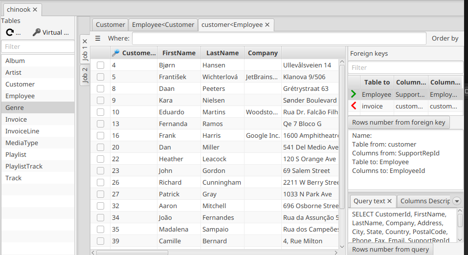
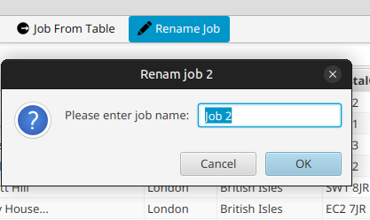

---

layout: default
title: Job tabs
resource: true
categories: [GUI]

---

## Job tabs

Double-clicking on a table in the [table list](Table-list) of a database, a [job](Jobs) containing that table is opened.
The tables deriving fro following foreign keys or applying queries to the tables of a job are 
themselves part of the job.   
Opening a second table in the table list, the fact that it is a second job is apparent because the jobs are showed as
tabs;

Tha job tabs have by default generic names ("job 1", "job 2" ...) but tbe name of a job can be changed
clicking on the **Rename job** button in the button panel of one of the jobs tables:

Immediately the job tab handle will get the new name.

A job can be closed (removed) just clicking on the X of its tab handle, in the smae way as for a table.

As we saw, new jobs can be created simply double-clicking on a table of the table list.
But there is another way: clicking on the **Job from table** button on the button panel of a table, 
a new job is created containing that table.
This can be useful, for example, to focus on that table and what can be derived from it.
